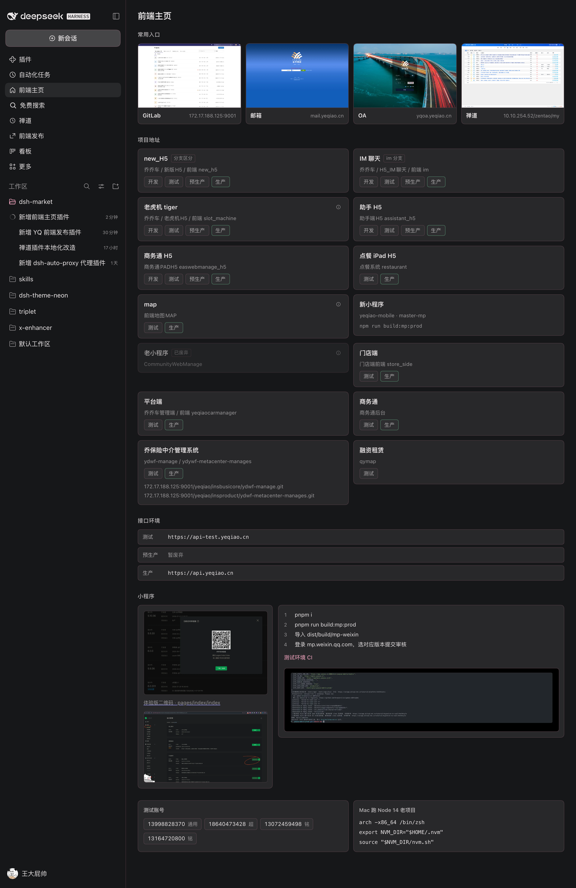

# 前端主页

一个标签页里看全前端项目的地址：开发、测试、预生产、生产各一份，点一下就在新标签页打开。

## 内容

- **常用入口**：GitLab、邮箱、OA、禅道，带截图，排在最上面。
- **项目地址**：每个项目一张卡，列出有值的环境（只有测试环境的项目就只显示测试）。
  卡片标题链到仓库，环境按钮链到对应环境。
- **接口环境**：测试与生产接口地址。
- **小程序**：体验版二维码、发版步骤、构建与提审截图。
- **测试账号**：只列手机号，不列密码。

## 说明

- 页面是纯静态的：地址、步骤、截图都写在 `lib/client.js` 里，没有接口请求，也没有配置项。
  改地址就改这个文件里的 `PROJECTS` / `ENTRIES` / `APIS`。
- 截图在 `assets/` 下，通过包的 `./assets/*` 导出，由 DSH 在
  `/plugins/dsh-plugin-fe-homepage/assets/<file>` 提供；体积压到 308 KB，加载不走网络。
- 密码不在这份代码里，也不在任何截图里。源文档中的账号只保留账号名。
- 颜色全部来自宿主的 `--dsw-alias-*` 变量，跟着主题走，不写死色值。
