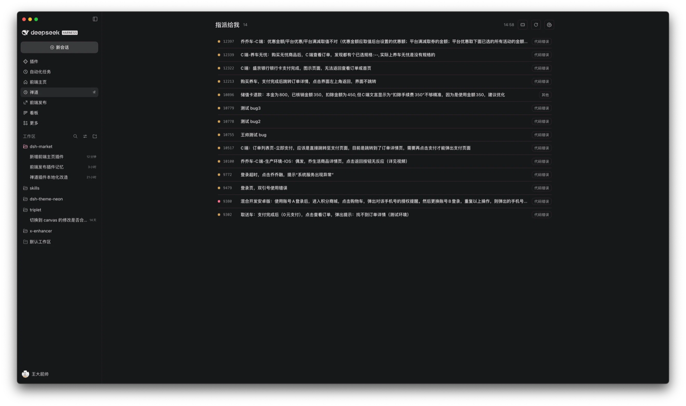
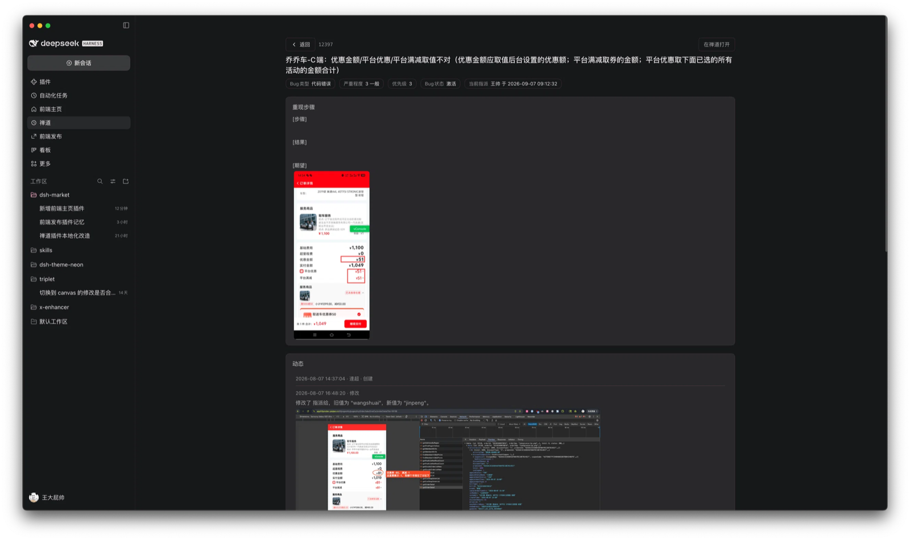

# 禅道





在 DSH 侧边栏里看「指派给我」的 Bug，点开就在面板内读详情，不跳出 DSH。

## 连接

第一次打开面板会让你填三项：禅道地址、账号、密码。

- 地址填安装根路径即可，例如 `http://10.10.254.52/zentao`。粘成 `/zentao/my/`、
  `/zentao/my-bug.html` 或某个 Bug 的链接也能识别，尾段会被自动去掉。
- 密码不存在配置文件里，而是存进 DSH 的凭据存储（引用名 `ZENTAO_PASSWORD`），
  只有宿主端进程读得到；浏览器端永远拿不到明文，也拿不到会话 Cookie。
- 已保存的密码在表单里显示成一串与密码等长的点；点进输入框才开始改，没输入就移开会恢复原样。
- 换账号或改密码后，面板会在下一次请求时重新登录。

## 面板

- 列表是禅道 `我的地盘 → 我的 Bug`（`my-bug.html`，按指派给我、ID 倒序），
  标题右侧显示条数和最近一次拉取的时间。
- 刷新按钮重新拉一次列表；齿轮按钮改连接配置。
- 列表右上角的宽度按钮切换内容栏宽度（标准 960 / 宽 1200），选择记在本机。
  详情跟着同一宽度，卡片与右上角按钮右边缘齐平。
- 点任意一行进入详情：标题、严重程度／优先级／状态等标签、重现步骤（含附件图）、
  动态（变更记录与评论）、属性表。左上角「返回」回到列表。
- 详情右上角「在禅道打开」在新标签页打开原页面——面板只读，改状态、写评论这些动作在那边做。
- 正文里的截图按 420px 高度显示，点一下展开，再点收起；正文里的链接也在新标签页打开。
- 详情先出文字、图片随后各自补上：文字通常 0.3–0.5 秒可读，最慢的大截图要十秒左右。
  每张图的位置按真实宽高预先占好，图片到位不会让正文重排。

## 读写范围

只读。这一版只做登录、拉列表、拉详情、取附件图四件事；指派、解决、编辑、评论
这些写操作仍然在禅道自己的界面里做。

## 实现要点

- `lib/config.js`：两个 `.volatile()` 配置项（地址、账号）与地址归一化。
- `lib/zentao.js`：表单登录（`md5(md5(密码) + verifyRand)`）、Cookie jar、
  手动跟随跳转、列表与详情解析。会话失效有两种表现——直接返回登录表单，或返回一段
  跳往 `user-login-<base64>.html` 的脚本页——两种都识别并自动重登一次。
- `lib/html.js`：正文白名单清洗（去 script／style／`on*` 属性，只留排版标签），
  以及把附件图的 `src` 换成按真实宽高定尺寸的占位块。
- `lib/index.js`：`/api/dsh-plugin-zentao/{state,settings,password,bugs,bug,image}` 六条
  本地桥路由，只接受回环地址的同源 POST。`/bug` 只回文字与图片清单，`/image` 逐张取
  附件，图片因此可以边到边显示，不必等最慢的那张。
- `lib/client.js`：侧边栏入口与面板页面。

会话只活在宿主端内存里：进程重启或插件重载后第一次请求会重新登录。

## 检查脚本

`scripts/` 是跑在真实浏览器里的验证脚本，不是插件运行时的一部分。

```bash
# DSH 起着、本机装了 Chrome 就能跑
node scripts/check.mjs            # 全部
node scripts/check.mjs align      # 只跑一项
```

PATH 里没有 `node` 时（macOS 的 DSH 就是这样），用自带运行时：

```bash
ELECTRON_RUN_AS_NODE=1 "/Applications/DeepSeek Harness.app/Contents/MacOS/DeepSeek Harness" \
  scripts/check.mjs
```

- `check-align.mjs`：详情页三张卡的右边缘与右上角按钮齐平，5 档视口都不出横向滚动。
- `check-latency.mjs`：详情文字多快可读（断言 < 2s）。
- `check-reflow.mjs`：截图逐张到位时版面不移动。

三项共用一个常驻 headless Chrome（端口 9601），第一次启动贵，之后每次只花一两秒。
`node scripts/chrome-stop.mjs` 关掉它。

会话 Cookie 由 `scripts/session-cookie.mjs` 用 profile 里的签名密钥现签，
所以脚本不需要登录。`ZT_WEB_URL` 覆盖目标地址，`ZT_CDP_PORT` 覆盖端口。
